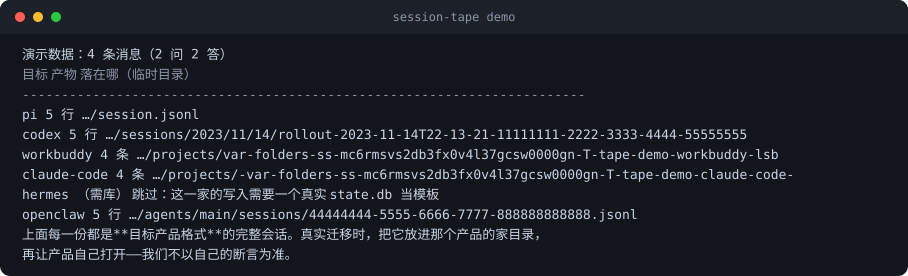

# session-tape

[中文](README.md) ｜ **English**

[](https://pypi.org/project/session-tape/)
[](https://github.com/yamingmou/session-tape/actions/workflows/ci.yml)
[](https://github.com/yamingmou/session-tape/tags)
[](LICENSE)
[](pyproject.toml)
[](pyproject.toml)

**Carry a coding-agent session from one CLI to another and keep talking.**

It moves the conversation — what you said, what the model answered — and nothing else. Tool calls, attachments, reasoning traces and model identity stay behind. Every product stores those differently, so reproducing them elsewhere wouldn't be faithful; it would just be fabricated.

What lands is a real session: the target tool opens it like one of its own and carries on its own way.



*The output above is real — `session-tape demo` reads four messages and writes one file per product, six times.*

## How it works

```
read session in A  →  normalise to (role, text, time)  →  write A's history in B's format  →  let B verify
```

That last step is the one that matters. Verification always uses **the target product itself** — its own session loader, its own list view, its own resume path. Assertions we write ourselves don't count, because "the file looks right" and "the tool accepts it" are different claims.

## Not a fork tool

| | What it does | Tool |
|---|---|---|
| **Branching** | Copies a prefix **inside one product**, keeping tool calls and full structure | [`session-fork`](https://github.com/yamingmou/session-fork-core) |
| **Migration** (this project) | Moves history **across products**, text only | session-tape |

Both read sessions through the same **adapter layer**, which is `session-fork`'s core asset — six products, each verified against the real tool. This project consumes that layer as a dependency rather than copying it: same reading, entirely different job.

> Branching inside a product? Use `session-fork`. Changing products? You're in the right place.

## How this differs from other approaches

Same problem, different trade-off — worth stating plainly:

| | session-tape | Wider-coverage tools |
|---|---|---|
| **Model** | Thin layer: normalise `(role, text, time)`, touch nothing else | Thick layer: model tool calls, reasoning, compaction boundaries, then map |
| **Products** | 6 (including WorkBuddy and OpenClaw) | A dozen or two |
| **How it lands** | Use the product's own shell where one exists (Codex `--fill`), then fill in history | Build the container ourselves, then register it |
| **Verification** | The target product reads, lists, resumes | Varies |

We're not racing for product count. This project is about the mechanism: get "it actually works after the move" right first. A thin layer makes the losses visible; a thick one covers more detail. Both are legitimate — this is the thin one.

## Support matrix

Reading and writing are independent, so the cost is N + M adapters rather than N × M converters.

| | pi | codex | WorkBuddy | Claude Code | Hermes | OpenClaw | OpenCode | Qwen |
|---|---|---|---|---|---|---|---|---|
| **read** (as source) | ✅ | ✅ | ✅ | ✅ | ✅ | ✅ | ✅ | ✅ |
| **write** (as target) | ✅ L3 | ✅ L3 | ✅ L3 | ✅ L1 | ✅ L2 | ✅ L1 | ✅ L3 | ✅ L3 |

Verification levels — labelled because mixing them would be self-deception:

| Level | Meaning |
|---|---|
| **L3** | The target tool loaded the session **and ran a real turn on top of it** |
| **L2** | Written into a copy of the product's own store, then read back **through that product's own reader** |
| **L1** | Format round-trip only (read back by a reader that mirrors the product's format); the product isn't installed here, so no real-device check |

Combinations exercised so far (2026-11-24): WorkBuddy→pi, WorkBuddy→codex, WorkBuddy→WorkBuddy (new directory), Codex→pi, Codex→codex, Codex→WorkBuddy, pi→codex, plus a **chained** WorkBuddy→pi→codex (29 → 29 → 29 messages, original timestamps preserved).

Per-case evidence and the exact commands to reproduce it: see [`docs/verification.md`](docs/verification.md) (Chinese).

> **One honest limit**: writing a file or a database row does not mean the product shows it. The only thing we can assert automatically is a proxy — that the product's consumption cursor sits at its initial value. **A passing proxy is not proof of visibility; a failing one is proof of invisibility.** See [`docs/verification.md`](docs/verification.md).


## Up and running in 60 seconds

### Install (pick one)

```sh
# ① simplest (published on PyPI)
pip install session-tape

# ② keep it out of your system Python
uv tool install session-tape      # or pipx install session-tape

# ③ one-liner: picks uv / pipx / pip and checks your Python version
curl -fsSL https://raw.githubusercontent.com/yamingmou/session-tape/main/install.sh | sh

# ④ don't install at all — clone and run (no runtime dependencies, Python 3.10+)
git clone https://github.com/yamingmou/session-tape && cd session-tape
python3 -m session_tape --help
```

> Just curious what it does? `session-tape demo` — no product installed, no real session needed.

### Use (simple first, precise when you want it)

```sh
session-tape demo          # see it work: four messages rendered into six products' formats
session-tape list          # see what you have: your local sessions, numbered
session-tape               # wizard: asks where from and where to, builds the arguments for you
```

The wizard walks you through: pick a source product → pick a session from a numbered list → pick a target → confirm where it lands → preview the exact command → go. **No ids to look up, no flags to memorise.**

Large sessions (a few MB) trigger a suggestion to move only the last few turns:

```sh
session-tape --from workbuddy --session <id> --to pi --out <dir> --limit 20
```

### Precise form (what the wizard generates)

```sh
# to pi — flat file: synthesise a header, chain the entries
session-tape --from workbuddy --session <id> --to pi --out <pi sessions dir>

# to codex — preferred: let Codex create the shell (fork in the UI), then fill it
session-tape --from workbuddy --session <id> --to codex \
  --fill <id of the session you just forked> --name "title"

# to codex — create the shell ourselves and register it
session-tape --from codex --session-file <rollout> --to codex \
  --install-codex-home ~/.codex --name "title"

# to WorkBuddy (point at a copy of the store first)
session-tape --from codex --session-file <rollout> --to workbuddy \
  --install-wb-home <dir with workbuddy.db and projects/> --name "title" --cwd <real dir>

# to Claude Code / Hermes / OpenClaw
session-tape --from workbuddy --session <id> --to claude-code --out ~/.claude
session-tape --from workbuddy --session <id> --to hermes      --out ~/.hermes/state.db
session-tape --from workbuddy --session <id> --to openclaw    --out ~/.openclaw
```

Shared flags: `--session-file` (point at a transcript when the source id is ambiguous), `--limit N` (last N turns, always cut on a turn boundary), `--dry-run`.

### Check it yourself

```sh
python3 scripts/selfcheck.py          # every check in one table; exit code 0 means all green

# real-device gate for pi: empty HOME, local protocol stub, no real key —
# asserts the history actually reached the model's context
python3 scripts/verify_gate_pi.py --pi <pi binary> --session <migrated file>
```

## Adding a target means answering three questions

The matrix doesn't turn green by itself.

1. **Where does the container come from?** Flat-file products let you synthesise it; database-backed ones need a row the product itself created as a template; when the product offers an official way to create a session, use it.
2. **How does the product learn about it?** Writing the file isn't enough — database-backed tools also need a registration row, or the session exists on disk and nowhere in the UI.
3. **How is it verified?** Through the product's own loader, list, or resume. Not through ours.

## What it deliberately doesn't do

1. **No implementation is migrated.** Tool calls, attachments, reasoning, workspace files stay behind. History reads correctly and the conversation continues; don't expect the tool actions to replay.
2. **One direction.** A → B. Going back means migrating again.
3. **Source stays read-only.** Nothing in the source product is modified.
4. **Model choice is yours.** The migrated session runs under the target tool's own model configuration.

## Layout

```
session_tape/
  source.py         read a source (via session-fork-core adapters) → normalise to Msg
  noise.py          drop placeholders and interruptions, collapse repeated deliveries
  render/           one writer per target: pi / codex / workbuddy / claude / hermes / openclaw
  cli.py            command line
scripts/
  verify_gate_pi.py real-device gate (protocol stub)
  selfcheck.py      one-command self check
tests/              contract tests and round-trip tests
reference/          upstream format and verification notes (MIT, attributed)
lab/                the earliest converter prototype, kept for comparison
```

## Roadmap

| Stage | Scope | Status |
|---|---|---|
| P0 | Hub structure + first writer (pi) | ✅ |
| P1 | Writers for all six products we can read | ✅ |
| P2 | **More products**: reader + writer + contract test each (candidates: opencode, cursor, kimi, qwen, gemini, cline, kilo) | 🚧 next |
| P3 | Same product, different machine: path and account field rewriting | todo |
| P4 | Fallback when the target isn't supported: compress the context into one pasteable message | todo |

## License

MIT. Third-party documents under `reference/` keep their own licenses and attribution.
