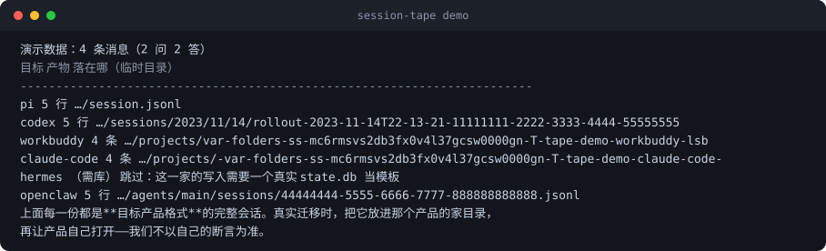

# session-tape

**中文** ｜ [English](README.en.md)

[](https://pypi.org/project/session-tape/)
[](https://github.com/yamingmou/session-tape/actions/workflows/ci.yml)
[](https://github.com/yamingmou/session-tape/tags)
[](LICENSE)
[](pyproject.toml)
[](pyproject.toml)

**把一个产品的会话历史，搬到另一个产品里继续。**

只搬**人说的话和模型的回答**——也就是历史。工具调用、附件、思考过程、模型身份都不搬：这些每家产品都不一样，搬过去也没有对应物，硬凑只会让新会话变得不可信。

搬过去之后，历史是**真历史**：目标产品把它当自己的会话打开，往下按它自己的方式跑。



*上图是 `session-tape demo` 的真实输出（读完 4 条消息，按 6 种产品的格式各写一份）。*

---

## 一分钟看懂

```
读 A 的历史  →  规范成 (角色, 文本, 时间)  →  按 B 的格式写出来  →  用 B 自己验收
```

关键在最后一步：**验收一律用目标产品自己**——它自己的解析器能不能读、列表里能不能出现、能不能接着聊。不用我们自己的断言自证。

## 它不是"打分支"

| | 做什么 | 用哪个 |
|---|---|---|
| **打分支** | **同一个产品内**复制一段前缀，保留工具调用与全部结构 | [`session-fork`](https://github.com/yamingmou/session-fork-core) |
| **会话迁移**（本项目） | **跨产品**搬运历史，只保留对话文本 | session-tape |

两者共用一套**读产品会话的适配器层**——那是 `session-fork` 的核心资产（六个产品逐个真机验过）。本项目**不复制**那份代码，直接把它当依赖：读到的东西一样，做的事完全不同。

> 如果你要的是"在同一个产品里从某个点重开"，用 `session-fork`；
> 如果你要的是"把我的历史换个产品继续"，用这里。

## 与同类项目的关系

同一件事还有别的做法，说清差异比说"我们更好"有用：

| | session-tape | 覆盖面更广的同类工具 |
|---|---|---|
| **做法** | 薄中间层：只归一化 `(角色, 文本, 时间)`，其余不碰 | 厚中间层：工具调用、思考、压缩边界都建模，再映射到各产品 |
| **产品覆盖** | 6 个（含 WorkBuddy、OpenClaw） | 十几个到二十个不等 |
| **落地方式** | 能"官方建壳"就官方建壳（如 Codex 的 `--fill`），我们只灌内容 | 自己造容器 + 自己登记 |
| **验收** | 一律用目标产品自己读 / 列 / 续跑 | 各家不同 |

我们**不打算**在产品数量上追平：这个项目的定位是**跨平台机制本身**，先把"搬过去真的能用"这件事做透。薄的好处是丢什么你一眼能看见；厚的好处是覆盖更多细节——两条路都成立，我们走前者。

## 支持矩阵

**读**（源）与**写**（目标）各自独立，任意组合都成立——所以是 N + M 条适配器，不是 N × M 条转换器。

| | pi | codex | WorkBuddy | Claude Code | Hermes | OpenClaw | OpenCode |
|---|---|---|---|---|---|---|---|
| **读**（作为源） | ✅ | ✅ | ✅ | ✅ | ✅ | ✅ | ✅ |
| **写**（作为目标） | ✅ L3 | ✅ L3 | ✅ L2 | ✅ L1 | ✅ L2 | ✅ L1 | ⚠️ **未通过** |

**验收等级**（混着写就是自欺，所以分级标注）：

| 等级 | 含义 |
|---|---|
| **L3** | 目标产品自己读下来 **+ 真的续跑一轮**（不只是"文件看起来对"） |
| **L2** | 写进产品的真实库/目录副本，用**产品自己的读法**读回，内容一致 |
| **L1** | 只有格式往返（用我们镜像产品格式的读器读回）；本机没装那个产品，未做真机 |

已跑通的组合（2026-11-24）：**OpenCode→pi**、Codex→WorkBuddy、WorkBuddy→pi、WorkBuddy→codex、WorkBuddy→WorkBuddy（换目录）、Codex→pi、Codex→codex、Codex→WorkBuddy、pi→codex，以及**链式** WorkBuddy→pi→codex（29 → 29 → 29 条，时间保留源的真实日期）。

逐条证据与自验命令见 [`docs/verification.md`](docs/verification.md)。

> **一处诚实的边界**：写进文件/库不等于产品看得见。我们只能自动断言"消费进度为初始值"这个代理指标——**代理指标通过 ≠ 产品可见，但它失败就一定看不见**。详见 [`docs/verification.md`](docs/verification.md)。


## 60 秒上手

### 装（三选一）

```sh
# ① 最省事（已发布在 PyPI）
pip install session-tape

# ② 想装在独立环境里，不碰系统 Python
uv tool install session-tape      # 或 pipx install session-tape

# ③ 一行装（自动挑 uv / pipx / pip，并检查 Python 版本）
curl -fsSL https://raw.githubusercontent.com/yamingmou/session-tape/main/install.sh | sh

# ④ 不装，克隆下来直接跑（运行时零依赖，Python 3.10+）
git clone https://github.com/yamingmou/session-tape && cd session-tape
python3 -m session_tape --help
```

> 只是想看看效果？`session-tape demo` —— 不需要装任何产品，也不需要你的真实会话。

### 用（从简单到精确）

```sh
session-tape demo          # ① 看效果：造 4 条消息，渲染成 6 种产品的格式，打印产物
session-tape list          # ② 看有什么：列出本机各产品的会话，带编号
session-tape               # ③ 向导：问你从哪搬到哪，替你拼好参数
```

向导会走这几步：选源产品 → 从列表里挑会话 → 选目标 → （目标需要的话）确认落地位置 → 预览要执行的命令 → 确认。**不需要记任何 id，也不需要背参数。**

大会话（几 MB 以上）会提醒你可以只搬最后几轮：

```sh
session-tape --from workbuddy --session <id> --to pi --out <目录> --limit 20
```

### 精确用法（向导只是替你拼这些）

```sh
# 搬到 pi（文件型：造头部 + 线性 id 链）
session-tape --from workbuddy --session <会话id> --to pi --out <pi 的 sessions 目录>

# 搬到 codex —— 推荐「官方建壳 + 灌内容」：
#   先在 Codex 界面上 fork 一条，拿到它的 id，再把历史灌进去
session-tape --from workbuddy --session <id> --to codex \
  --fill <界面 fork 出来的 id> --name "标题"

# 搬到 codex —— 自己造壳 + 登记（没有官方壳时）
session-tape --from codex --session-file <某 rollout> --to codex \
  --install-codex-home ~/.codex --name "标题"

# 搬到 WorkBuddy（建议先指到库副本，确认无误再写真实库）
session-tape --from codex --session-file <某 rollout> --to workbuddy \
  --install-wb-home <含 workbuddy.db 与 projects/ 的目录> --name "标题" --cwd <真实目录>

# 搬到 Claude Code / Hermes / OpenClaw
session-tape --from workbuddy --session <id> --to claude-code --out ~/.claude
session-tape --from workbuddy --session <id> --to hermes      --out ~/.hermes/state.db
session-tape --from workbuddy --session <id> --to openclaw    --out ~/.openclaw
```

通用开关：`--session-file`（源 id 有歧义时直接指文件）、`--limit N`（只搬最后几轮，落在轮边界上）、`--dry-run`（只统计不落盘）。

### 自己验

```sh
python3 scripts/selfcheck.py     # 一条命令跑完全部检查，打印表格；退出码 0 = 全过

# pi 的真机门禁：空 HOME + 本地协议桩 + 假 key，断言「历史真的进了上下文」
python3 scripts/verify_gate_pi.py --pi <pi 可执行文件> --session <迁移产物>
```

## 每个新目标必须回答三件事

矩阵不会自己变绿。加一个目标产品，必须能把这三问答完：

1. **容器怎么来** —— 文件型自己造头部；库型拿产品自己建的一条当模板；能"官方建壳"的优先用官方（codex 的 `--fill` 就是这么来的）；
2. **怎么让产品看见** —— 只写文件不够：库型产品要补登记一行，否则文件在、列表里没有；
3. **怎么验** —— 用产品自己的解析器 / 列表 / 续跑。我们自己的断言不算。

## 它不做什么

1. **不搬实现**：工具调用、附件、思考过程、工作区文件都不搬。所以历史"读得通、能接着聊"，但**别指望它在 B 里重放当初的工具动作**。
2. **单向**：A → B。在 B 里继续之后想回 A，那是再做一次迁移。
3. **不改源**：读源产品时只读，不动任何文件。
4. **不替你决定模型**：目标会话按目标产品自己的模型配置跑。

## 目录

```
session_tape/
  source.py         读源（调 session-fork-core 的适配器）→ 规范化成 Msg
  noise.py          丢掉占位/中断文本、合并重复投递
  render/           每个目标一个写入器：pi / codex / workbuddy / claude / hermes / openclaw
  cli.py            命令行
scripts/
  verify_gate_pi.py 真机门禁（协议桩）
  selfcheck.py      一键自检
tests/              契约测试与往返测试
reference/          上游项目的格式与验收文档（MIT，注明出处）
lab/                最早的转换原型，留作对照
```

## 路线图

| 阶段 | 内容 | 状态 |
|---|---|---|
| P0 | 枢纽结构 + 首个写入器（pi） | ✅ |
| P1 | 六个目标写入器（本仓库已有读器的全部产品） | ✅ |
| P2 | **扩产品覆盖**：新产品 = 读器 + 写器 + 契约测试（候选：opencode、cursor、kimi、qwen、gemini、cline、kilo） | 🚧 下一步 |
| P3 | 同产品跨机：路径与账号字段的改写 | 待做 |
| P4 | 兜底：目标不在支持表内时，退化为「把上下文压成一条可粘贴的消息」 | 待做 |

## 许可

MIT。`reference/` 下的第三方文档各自保留其许可证与出处。
